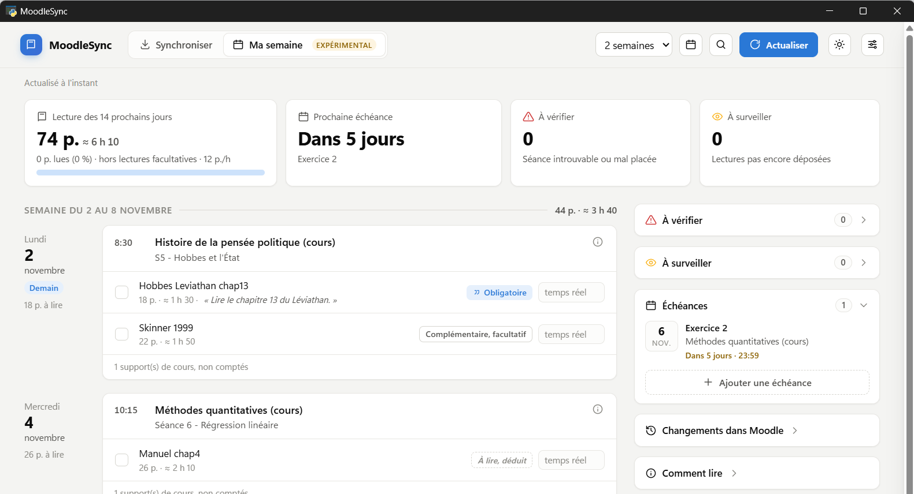
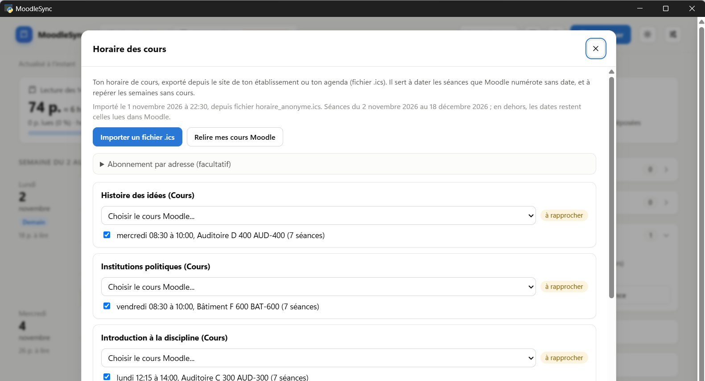

# MoodleSync

Tes fichiers Moodle, téléchargés et rangés par cours, par section et par statut de lecture.
Une fenêtre, sous Windows ou macOS, aucune ligne de commande.

Développé et testé sur le Moodle de l'UNIL, il est conçu pour fonctionner avec n'importe quel
Moodle dont l'établissement autorise l'accès par l'application mobile (voir « Autres Moodle »).
À l'usage des étudiants qui veulent retrouver leurs documents de cours proprement classés
sans le faire à la main.

Depuis la version 2.0, un second onglet, **Ma semaine** (expérimental, désactivé par défaut),
présente les séances et les lectures des jours à venir. Voir « Ma semaine ».


---

## Ce que fait le programme

- **Connexion dans le navigateur, avec la méthode de ton établissement** (SWITCH edu-ID à
  l'UNIL, identifiant local ou autre ailleurs). Tu indiques l'adresse de ton Moodle, la fenêtre
  ouvre Chrome (ou Edge sous Windows, si Chrome n'est pas installé), tu te connectes normalement,
  et le programme récupère une autorisation temporaire valable plusieurs semaines. Le mot de passe
  n'est jamais stocké.
- **Liste de tes cours** avec le nombre de fichiers et le volume de chacun, à cocher ou décocher.
  À côté de chaque cours, une pastille indique combien de fichiers sont nouveaux ou republiés
  sur Moodle depuis la dernière synchronisation, avant même de lancer le téléchargement.
- **Téléchargement idempotent.** Un fichier déjà présent n'est pas retéléchargé, même s'il a
  été renommé par l'enseignant : la comparaison porte aussi sur le contenu.
- **Fichiers mis à jour.** Si l'enseignant remplace un document, la nouvelle version est
  téléchargée et l'ancienne est conservée sous un nom explicite (`... (ancienne version 2026-10-29).pdf`).
- **Rangement automatique** dans le dossier que tu choisis, avec renommage des dossiers de cours
  (bouton crayon) et sous-dossiers imbriqués si tu veux.
- **Statuts de lecture en option** : Obligatoire, Complémentaire, Pour aller plus loin,
  Supports de cours. Ils viennent de ce que l'enseignant a écrit dans Moodle : étiquettes,
  sous-sections, noms de dossiers, et liste de lectures placée en tête de chaque séance. Seuls les
  supports de cours (diapos, syllabus, consignes) sont aussi reconnus sans indication de
  l'enseignant (voir « À propos des statuts »).
- **Langue des dossiers et du classement** : français ou anglais. Elle règle les noms des
  sous-dossiers de statut, ceux des notes (`Nouveautés Moodle.md` ou `Moodle updates.md`) et
  les mots-clés reconnus dans les étiquettes et les noms de fichiers. L'interface elle-même reste en français.
- **Note de nouveautés** : un fichier `Nouveautés Moodle.md` liste ce qui a été ajouté ou
  modifié lors de la synchronisation.
- **Page de liens** : les liens externes déposés par les enseignants (articles, vidéos) sont
  rassemblés dans `Liens Moodle.md`, section par section, puisque ce ne sont pas des fichiers.
  Le titre des vidéos YouTube est cherché sur youtube.com ; une case des options le désactive.
- **Bouton Annuler** pendant une synchronisation : le fichier en cours est abandonné, ceux déjà
  téléchargés restent rangés, et le reste viendra à la synchronisation suivante.
- **Journal** et lancement automatique possible à l'ouverture de session, sans fenêtre. Dans ce
  mode, une notification du système (Windows ou macOS) annonce les nouveautés, cours par cours ;
  rien ne s'affiche s'il n'y a rien de nouveau.

## Ce que le programme ne fait pas

- Il ne récupère pas les devoirs, forums, quiz et tests : ce ne sont pas des fichiers.
- Il ne suit pas les liens vers des sites externes, il les liste seulement.
- Il ne s'inscrit à aucun cours et ne modifie rien sur Moodle.
- Il ne contourne aucune authentification : il accède à ce à quoi l'étudiant a déjà droit.

## Installation

### Version prête à l'emploi (Windows)

Télécharge `MoodleSync.exe` dans la page **Releases** de ce dépôt, place-le où tu veux,
et double-clique dessus. Windows affichera un avertissement d'éditeur inconnu, l'exécutable
n'étant pas signé : « Informations complémentaires » puis « Exécuter quand même ».

Prérequis : Windows 10 ou 11, et un Moodle qui autorise l'accès mobile. La connexion passe par
Google Chrome s'il est installé, sinon par Microsoft Edge, présent sur tous les Windows. La
fenêtre utilise le composant Microsoft Edge WebView2, présent sur Windows 11 et sur Windows 10 à
jour ; s'il manque, le programme le dit et donne l'adresse pour l'installer.

### Sur Mac

Télécharge `MoodleSync-macOS.zip` (page **Releases**), décompresse-le et place `MoodleSync.app`
dans **Applications**. L'application n'étant pas signée, macOS la bloque au premier lancement :
double-clique, ferme le message, puis **Réglages Système › Confidentialité et sécurité ›
Ouvrir quand même**. Elle est compilée pour les Mac à puce Apple (M1 et suivants).

Prérequis : Google Chrome installé. La synchronisation automatique passe par un agent de
lancement (`~/Library/LaunchAgents/ch.moodlesync.plist`), sans droit administrateur.

**La version 2.0 est une pré-version pour Mac** : elle est compilée et essayée automatiquement
sur une machine Mac de GitHub (lancement, connexion HTTPS, ouverture de la fenêtre), mais elle
n'a pas encore été essayée à la main sur un vrai Mac. La version 1.3 reste disponible dans les
Releases. Un retour (ticket) est le bienvenu.

### Depuis le code source

Python 3.12 ou plus récent.

```
python -m pip install -r requirements.txt
python -m moodlesync
```

## Utilisation

1. Indique l'adresse de ton Moodle (par exemple `https://moodle.unil.ch`), puis clique sur
   **Se connecter**. Chrome (ou Edge) s'ouvre : connecte-toi comme d'habitude, reviens dans la
   fenêtre. La connexion est détectée toute seule.


2. Choisis le dossier de rangement avec **Changer…**, la langue des dossiers, puis coche les
   cours voulus.
3. Clique sur **Télécharger et ranger**.

À la fin, la fenêtre indique le nombre de fichiers nouveaux et mis à jour, cours par cours, et
où se trouve la note de nouveautés.


Au lancement suivant, il ne reste que l'étape 3. Si la session a expiré, le programme le dit
et propose de se reconnecter.

## Rangement produit


```
<dossier choisi>\
    Institutions et régimes politiques\
        Enseignement du 30.10.2026\
            Supports de cours\
                7_Conférence du Prof Raul Bolo-Rapti.pdf
            Obligatoire\
                S6-Marx2022-LeCapital-Chap1-1.pdf
```

La couche `Obligatoire` / `Complémentaire` / `Pour aller plus loin` / `Supports de cours` (en
anglais `Required` / `Supplementary` / `Further reading` / `Course material`) est optionnelle,
désactivée par défaut. Un dossier de cours se renomme avec son crayon, jamais dans l'explorateur
(MoodleSync ne retrouverait plus les fichiers). Une barre oblique inverse permet d'imbriquer, par
exemple `Introduction aux théories économiques\SITE (séminaire)`.

## À propos des statuts

Les enseignants indiquent le statut d'une lecture de plusieurs façons. Le programme en lit
quatre, dans cet ordre :

1. **Une étiquette** placée avant les fichiers (« Lectures obligatoires », « Diapos »...).
2. **Le nom du dossier Moodle** qui contient les fichiers (« Documents et lectures
   complémentaires »).
3. **La liste de lectures écrite en tête de la séance**, sous des intitulés comme « Lectures
   obligatoires : », « Lectures facultatives : », « Pour aller plus loin : ». Les fichiers y sont
   rapprochés des références par l'auteur, l'année et les mots du titre (voir plus bas).
4. **Une sous-section** dont le nom annonce un statut (« Lecture obligatoire » à l'intérieur de
   la séance du 12 octobre). Ses fichiers sont rangés dans le dossier de la séance, et non plus
   dans un dossier à part, détaché de sa date.

Seul le début d'une ligne compte comme intitulé : « L'inscription au séminaire est obligatoire »
ou « Formation obligatoire à Zotero » ne font pas d'un document une lecture obligatoire.

**Rapprochement avec la liste de lectures.** Un fichier n'est rattaché à une référence que si son
nom en reprend l'auteur et l'année, ou l'auteur et un mot propre à cette référence, ou plusieurs
auteurs ou mots du titre, et si ses mots se retrouvent en majorité dans la référence. Les
coquilles légères (« Barraul » pour « Barrault ») et les apostrophes perdues (« LEtat ») sont
tolérées. Dans le doute, rien n'est décidé : un auteur cité deux fois avec deux statuts
différents (un chapitre obligatoire, un autre « pour aller plus loin ») laisse ses fichiers sans
statut, et un texte déposé sans figurer dans la liste n'en reçoit pas. Les diapositives ne sont
jamais rapprochées d'une référence. Le journal indique combien de fichiers ont été classés ainsi.

Mesure sur le séminaire d'Introduction à la science politique de l'UNIL (automne 2026), comparée
au classement fait à la main par l'auteur : sur 39 fichiers cités sous un intitulé, 37 sont
classés, tous dans le bon statut, et 2 restent sans statut (le cas de l'auteur cité deux fois).
Un seul cours ne prouve pas que la règle vaut ailleurs : d'autres formats de liste de lectures
seront moins bien reconnus.

**Sans étiquette, le programme ne déduit que les supports de cours.** Un fichier est classé en
`Supports de cours` quand son extension est celle d'une présentation (`.pptx`, `.key`...) ou
que le nom du fichier ou de son activité Moodle désigne un document de l'enseignant : diapos,
slides, syllabus, consignes, fiche, calendrier, présentation, QCM. Une liste de lectures
(« Syllabus de lectures ») n'en fait pas partie. Chaque synchronisation indique dans le journal
combien de fichiers ont été classés ainsi, par déduction et non d'après l'enseignant.

**Obligatoire, Complémentaire et Pour aller plus loin ne sont jamais devinés** dans le rangement.
Seul ce que l'enseignant a écrit dans Moodle les donne. Un texte qu'aucune indication ne désigne
reste donc directement dans le dossier de sa section, y compris quand l'option est activée. Le
syllabus en PDF n'est pas lu.

Mesure sur un jeu de 248 fichiers de cours que l'auteur avait rangés à la main : les 60 fichiers
déduits comme supports de cours l'étaient tous bien (60 sur 60), mais la règle n'en reconnaît pas
31 autres, qui restent non classés. Ce jeu a servi à choisir les mots-clés : le résultat sur
d'autres cours sera moins bon, et une déduction peut se tromper.

Les intitulés sont reconnus en français ou en anglais selon la langue choisie. Un intitulé
rédigé dans une autre langue n'est pas reconnu.

**Fichiers déjà rangés.** Un nouveau classement ne déplace jamais un fichier déjà téléchargé :
seuls les nouveaux fichiers suivent les nouvelles règles.

## Ma semaine (expérimental)

Désactivé par défaut ; l'onglet **Ma semaine** présente ses limites et un bouton pour l'activer.
Il lit Moodle **en lecture seule**, avec la même connexion que la synchronisation.



**Ce qu'il fait.** Pour la période choisie (1 semaine à 1 mois), il liste les séances de tes
cours, jour par jour, avec les lectures de chacune, leur nombre de pages et une durée estimée ;
les échéances de Moodle (devoirs, forums à délai) et celles que tu ajoutes à la main ; ce qui a
changé dans Moodle depuis la dernière fois (séance déplacée, lecture ajoutée ou retirée), gardé
jusqu'à ce que tu le marques comme vu ; et des contrôles de cohérence (séance introuvable, mal
placée, lectures pas encore déposées). Tu coches ce que tu as lu et tu notes le temps réel passé :
le programme en tire ta vitesse de lecture mesurée. Un **audit du semestre** compare, cours par
cours, ce qu'il a su lire des séances déjà passées, pour repérer un cours mal lu avant qu'une
lecture manque.

**D'où viennent les dates.** Des titres des sections Moodle (« Séance 2 - 28 septembre 2026 »,
« S2 - 23/09 », « 14 septembre - 20 septembre »...), l'année étant déduite du semestre quand elle
manque. Une séance numérotée sans date est datée d'après les séances datées du même cours et le
jour habituel du cours. Si tu importes ton **horaire de cours** (fichier `.ics`), il donne en
plus le jour, l'heure et la date réelle de chaque séance qu'il couvre ; en dehors de la période
qu'il couvre, les dates restent celles lues dans Moodle. Une semaine annoncée sans cours dans
Moodle l'emporte sur le fichier `.ics`.



**L'horaire `.ics`.** Exporte-le depuis le site de ton établissement ou ton agenda, puis
**Importer un fichier .ics** ; ou colle une adresse d'abonnement (facultatif), relue à chaque
actualisation. Quand un même cours apparaît sur plusieurs créneaux (groupes de séminaire), coche
celui ou ceux que tu suis : chaque groupe est décrit par son jour, ses heures et sa salle. Chaque
cours du fichier est rapproché d'un cours Moodle par son nom ; le programme propose, tu confirmes,
et un rapprochement non confirmé ne sert jamais à dater. Les répétitions hebdomadaires (« chaque
mardi jusqu'au 18 décembre ») sont lues ; une autre règle de répétition est signalée, jamais
devinée. Les heures sont lues telles qu'écrites dans le fichier ; les événements d'une journée
entière sont ignorés.

**Quelles lectures.** Celles que l'enseignant désigne (étiquette, liste de lectures, consigne
comme « Lire le chapitre 13 », dont les pages sont alors comptées), et, à défaut, les fichiers
d'une séance qui ne sont pas des supports de cours. Ces dernières sont marquées **« À lire,
déduit »** : rien ne dit qu'elles sont à lire. Sur les cours de l'auteur (10 cours, 58 lectures
déduites, jugées à la main par l'auteur), environ un quart étaient fausses : diapositives
numérotées, documents de TP, une vidéo. Les lectures complémentaires et « pour aller plus loin »
sont affichées mais ne comptent pas dans la charge.

**Durées.** Pages à lire divisées par une vitesse en pages par heure. Vitesses proposées (400 mots
par page, hypothèse non mesurée) : Courante, 35 p./h (238 mots par minute, Brysbaert 2019) ;
Attentive, 21 p./h (Carver 1992, rapporté par Brysbaert) ; **Étude, 12 p./h, valeur par défaut
proposée sans source** ; Approfondie, 6 p./h (norme de la VU Amsterdam). Seuls tes temps réels
notés donnent une vitesse fondée sur toi.

**`Ma semaine.md`.** À chaque actualisation, la même chose est écrite dans un fichier Markdown du
dossier de rangement, lisible dans Obsidian ou un éditeur de texte. Ce que tu y coches, les temps
notés (`réel : 70`) et les échéances écrites dans « Mes échéances » sont repris par la fenêtre, et
inversement ; la section « Notes » est conservée. Un fichier du même nom sans la marque de
MoodleSync n'est jamais touché. L'export se désactive dans les réglages de Ma semaine. En mode
automatique, le fichier est aussi mis à jour après chaque synchronisation.

**Limites.** Dates lues en **français seulement** : un cours qui date ses séances en anglais, ou
pas du tout, sera mal daté ou listé « à dater ». Testé sur un seul étudiant, une faculté et un
semestre de l'UNIL. Chaque actualisation relit tous tes cours (de 20 secondes à une minute) et
peut télécharger des PDF pour compter leurs pages ; ils restent en cache sur l'ordinateur.

## Données personnelles

Les réglages, le jeton de session, le journal et le suivi de Ma semaine restent sur l'ordinateur,
dans `%LOCALAPPDATA%\MoodleSync` (Windows) ou `~/Library/Application Support/MoodleSync` (macOS) :
`config.json` (réglages et jeton), `journal.txt` (mode automatique), `erreurs.txt` (détail
technique des erreurs), les fichiers `ma_semaine*.json` et `horaire*.json`, le cache `cache_pages`
(PDF lus pour compter leurs pages), `webview` (données de la fenêtre) et les profils du
navigateur piloté (`profil_chrome`, `profil_edge`).

Accès réseau du programme, et seulement ceux-ci :

- **Ton Moodle**, avec ton jeton, en lecture seule.
- **youtube.com**, pour le titre des vidéos citées dans les liens : seule l'adresse de la vidéo est
  envoyée. Désactivable (case « Chercher le titre des vidéos YouTube »).
- **L'adresse d'abonnement de ton horaire**, seulement si tu en as collé une : une requête HTTPS à
  chaque actualisation de Ma semaine, sans jeton, sans nom ni cours (le serveur reçoit l'adresse,
  qui peut contenir un code personnel, et ton adresse IP). Vider le champ arrête l'abonnement.
- **À la connexion, le pilote du navigateur.** Selenium, qui pilote Chrome ou Edge, télécharge le
  pilote adapté (chromedriver depuis les serveurs de Google, msedgedriver depuis ceux de
  Microsoft) s'il ne le trouve pas déjà sur l'ordinateur. Son envoi de statistiques d'usage
  anonymes est désactivé par le programme (variable `SE_AVOID_STATS`) ; ce réglage est déduit de
  la documentation et du code de Selenium, sans observation du trafic réseau.

Les notifications sont locales.

Pour tout effacer : supprime ce dossier, ainsi que les fichiers téléchargés. Sous Windows, les
notifications ont aussi inscrit le nom de l'application dans
`HKEY_CURRENT_USER\Software\Classes\AppUserModelId\MoodleSync`, qu'on peut supprimer avec
l'Éditeur du Registre.

Aucun jeton, aucun mot de passe et aucun fichier de cours ne doit être publié dans ce dépôt.

## Construire l'exécutable

```
python -m pip install -r requirements-compilation.txt
python -m unittest discover -s tests -t .
pyinstaller --noconfirm --clean MoodleSync.spec
```

`requirements.txt` fixe les versions exactes de ce qui est embarqué (Selenium, pywebview,
pypdf...), `requirements-compilation.txt` y ajoute PyInstaller (et Pillow sur Mac, pour l'icône).
La recette `MoodleSync.spec` produit `dist\MoodleSync.exe` sous Windows et `dist/MoodleSync.app`
sous macOS ; la version vient de `moodlesync/__init__.py`.

Le workflow `.github/workflows/compilation.yml` lance les tests, compile et essaie le `.exe` et le
`.app` sur des machines Windows et Mac de GitHub à chaque envoi. Pour publier une version, il
suffit d'envoyer une étiquette `vX.Y` (`git tag v2.0` puis `git push origin v2.0`) : le workflow
crée alors une pré-version avec les deux exécutables, `docs/LISEZ-MOI.txt` et les notes de
`docs/notes-version.md`.

Organisation du code : `moodlesync/moteur.py` (connexion, API Moodle, téléchargement et
rangement), `seances.py`, `semaine.py`, `suivi.py`, `horaire.py` et `ics.py` (Ma semaine),
`application.py` et `interface/` (la fenêtre), `__main__.py` (lancement, mode `--auto`). Tests hors
ligne dans `tests/`.

## Autres Moodle

L'adresse du Moodle se règle dans la fenêtre (champ « Adresse de ton Moodle »), plus dans le
code. Changer d'adresse déconnecte l'ancienne session et oublie la liste de cours ; les fichiers
déjà téléchargés ne sont pas touchés.

La connexion ne dépend pas de la méthode d'authentification : c'est le navigateur qui la gère, puis le
programme échange la session contre un jeton de service web par le mécanisme de l'application
mobile officielle de Moodle. Deux conséquences.

- **L'établissement doit autoriser l'application mobile.** Certains la désactivent
  (réglage « Moodle mobile web service »). Dans ce cas, MoodleSync ne peut pas fonctionner : le
  programme l'indique par un message dès la vérification de l'adresse ou juste après la
  connexion. Ce n'est un problème ni de ton compte ni de ton mot de passe, et seul
  l'administrateur Moodle de l'établissement peut y changer quelque chose.
- **Seul le Moodle de l'UNIL a été testé.** Les thèmes et les versions varient. Si, après
  connexion, la page n'affiche pas le menu utilisateur habituel de Moodle, le programme déduit la
  connexion de l'adresse de la page et du jeton obtenu, et affiche « Statut inconnu : connexion
  probable » au lieu de « Connecté ». Si tu l'essaies sur un autre Moodle, un retour (ouvre une
  *issue*) est le bienvenu.

## Limites connues

- Un Moodle qui désactive l'accès mobile est inutilisable avec ce programme (voir « Autres Moodle »).
- Les statuts ne couvrent qu'une partie des fichiers : sans indication de l'enseignant, seuls
  les supports de cours à nom explicite sont classés. Les autres restent dans leur section.
- Le rapprochement avec une liste de lectures dépend du nom donné au fichier : un fichier nommé
  `Browning_chap7.pdf`, sans année ni titre, ne peut pas être rattaché avec certitude.
- Annuler n'interrompt pas la lecture de la liste des cours en cours de route : l'arrêt se fait
  entre deux cours, ou entre deux blocs d'un téléchargement.
- La langue ne change que les noms de dossiers, de notes et la reconnaissance des étiquettes,
  pas l'interface. Changer de langue ne renomme pas ce qui est déjà rangé : seuls les nouveaux
  fichiers et les nouvelles notes suivent.
- La version macOS est compilée et essayée automatiquement en ligne, mais n'a pas encore été
  essayée à la main sur un vrai Mac.
- La connexion demande Chrome, ou Edge sous Windows. Le navigateur est piloté par le programme
  (Selenium), seul moyen de lire le cookie de session : le navigateur par défaut, s'il est
  autre (Firefox, Safari...), n'est pas utilisé. Sur Mac, Chrome reste obligatoire.
- Les noms de sections viennent de Moodle : ils changent d'un cours et d'un enseignant à l'autre.
- Ma semaine est expérimental : voir ses limites dans la section « Ma semaine ».
- Le premier lancement est le plus fragile : antivirus, dossier OneDrive en lecture seule,
  session expirée. Les messages d'erreur sont écrits pour être compris sans être développeur.

## Licence

MIT, voir `LICENSE`. Les documents téléchargés restent la propriété de leurs auteurs et de
l'UNIL : cet outil ne les rediffuse pas, il les range sur ton disque.
