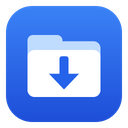
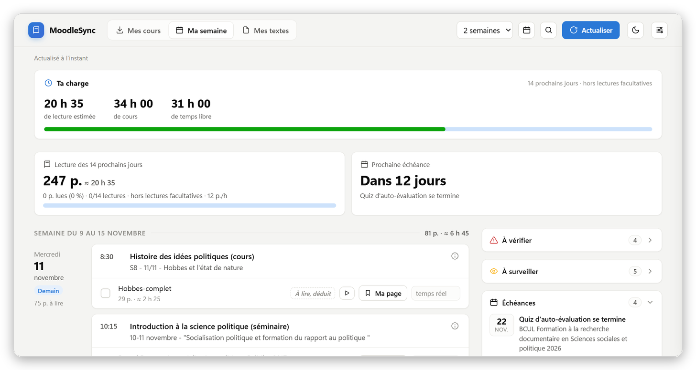
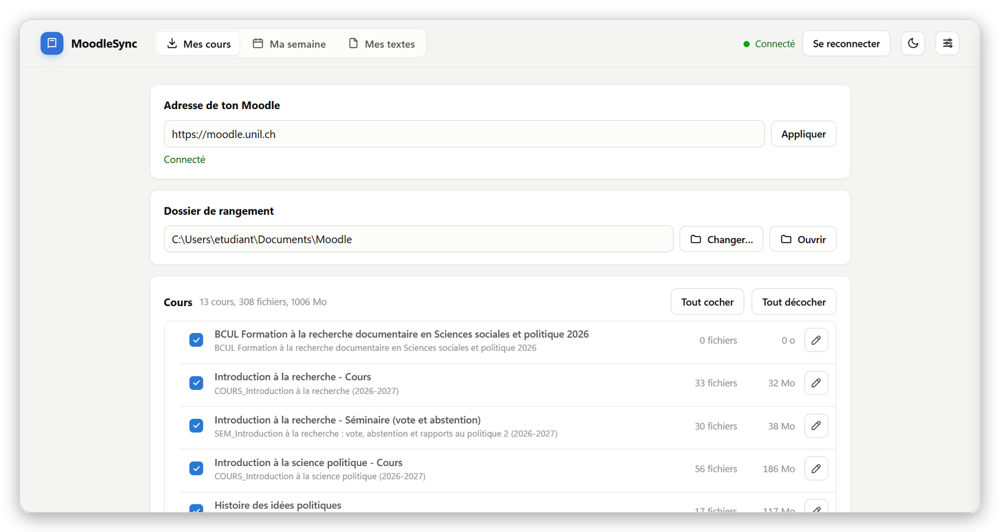
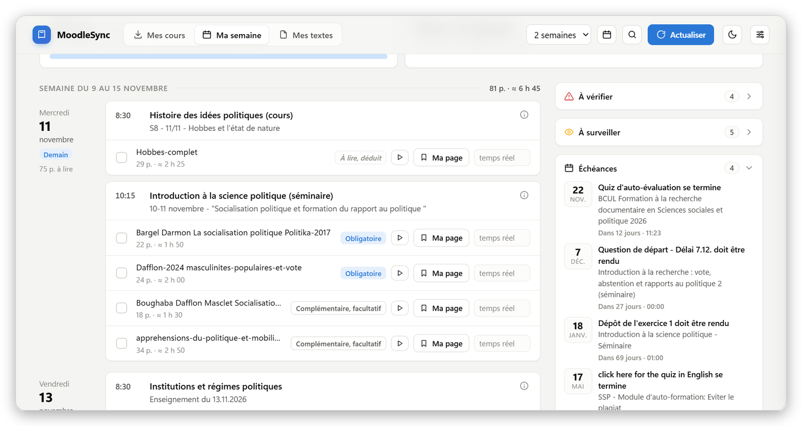
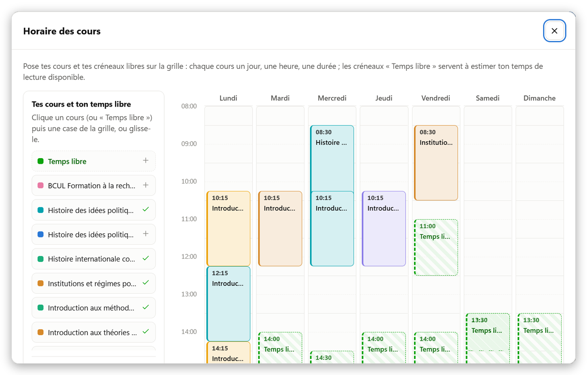
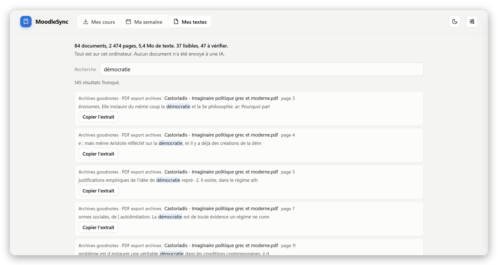

<div align="center">



# MoodleSync

**Tes cours Moodle, rangés tout seuls. Ta semaine de lecture, planifiée.**

Une petite application gratuite pour étudiants : elle télécharge tes fichiers Moodle, les range, te dit quoi lire et quand, et rend tes PDF scannés cherchables.

[](../../releases/latest)
[](LICENSE)


[](https://github.com/MarinWasAsleep/MoodleSync/releases/latest/download/MoodleSync.exe)
&nbsp;
[](https://github.com/MarinWasAsleep/MoodleSync/releases/latest/download/MoodleSync-macOS.zip)

<br>

<picture>
  <source media="(prefers-color-scheme: dark)" srcset="https://raw.githubusercontent.com/MarinWasAsleep/MoodleSync/main/docs/screenshots/semaine-dark.png">
  
</picture>

</div>

---

## ✨ Trois onglets, une seule fenêtre

<table>
<tr>
<td width="33%" valign="top">

### 📁 Mes cours

Tous les fichiers de tes cours, téléchargés et **rangés par cours, par séance et par statut** (obligatoire, complémentaire...). Rien n'est téléchargé deux fois.

</td>
<td width="33%" valign="top">

### 📅 Ma semaine

**Quoi lire, pour quand, et combien de temps.** Ta charge de la semaine face à ton temps libre, les échéances, et un marque-page pour lire en plusieurs fois.

</td>
<td width="33%" valign="top">

### 📄 Mes textes

Le texte de tes cours, **même des PDF scannés** : cherche un mot dans tous tes documents, copie un extrait, exporte le tout.

</td>
</tr>
</table>

## 💡 Pourquoi c'est pratique

- **Zéro tri à la main.** Les fichiers arrivent déjà dans les bons dossiers.
- **Tu vois ce qui est nouveau** avant même de télécharger.
- **Rien ne se perd.** Quand un enseignant met un document à jour, l'ancienne version est gardée à côté.
- **Ta semaine d'un coup d'œil.** Séances, lectures, durées estimées, échéances.
- **Tout reste sur ton ordinateur.** Pas de compte à créer, pas de serveur, aucun document envoyé ailleurs.

## 🚀 Installer en une minute

| | Windows 10 ou 11 | macOS (Mac à puce Apple) |
|---|---|---|
| **1. Télécharger** | [`MoodleSync.exe`](https://github.com/MarinWasAsleep/MoodleSync/releases/latest/download/MoodleSync.exe) | [`MoodleSync-macOS.zip`](https://github.com/MarinWasAsleep/MoodleSync/releases/latest/download/MoodleSync-macOS.zip), puis décompresse |
| **2. Ranger** | où tu veux | `MoodleSync.app` dans **Applications** |
| **3. Ouvrir** | double-clic | double-clic |
| **Premier lancement** | avertissement d'éditeur inconnu (l'application n'est pas signée) : **Informations complémentaires** puis **Exécuter quand même** | macOS la bloque (non signée) : **Réglages Système › Confidentialité et sécurité › Ouvrir quand même** |
| **Il te faut** | Chrome ou Edge | Google Chrome |

> [!NOTE]
> La version Mac est compilée et essayée automatiquement à chaque version, mais jamais à la main sur un vrai Mac. Un retour ([ticket](../../issues)) est le bienvenu.

Ensuite, MoodleSync se met à jour tout seul : un bandeau te prévient quand une nouvelle version sort, et rien ne s'installe sans ton accord.

## 🧭 Utilisation : trois étapes, une seule fois

1. **Connecte-toi.** Indique l'adresse de ton Moodle (par exemple `https://moodle.unil.ch`) et clique **Se connecter**. Ton navigateur s'ouvre : connecte-toi comme d'habitude, puis reviens. Ton mot de passe n'est jamais enregistré.
2. **Choisis** le dossier de rangement et coche tes cours.
3. Clique **Télécharger et ranger**.

Les fois suivantes, il ne reste que l'étape 3.

> Conçu et testé sur le Moodle de l'UNIL, MoodleSync fonctionne avec tout Moodle qui autorise l'application mobile Moodle.

## 📸 En images

<details open>
<summary><b>📁 Mes cours</b> : tes cours, le nombre de fichiers, ce qui est nouveau</summary>
<br>
<picture>
  <source media="(prefers-color-scheme: dark)" srcset="https://raw.githubusercontent.com/MarinWasAsleep/MoodleSync/main/docs/screenshots/cours-dark.png">
  
</picture>

Et le résultat dans ton explorateur de fichiers :


</details>

<details open>
<summary><b>📅 Ma semaine</b> : chaque séance, quoi lire avant, combien de temps</summary>
<br>
<picture>
  <source media="(prefers-color-scheme: dark)" srcset="https://raw.githubusercontent.com/MarinWasAsleep/MoodleSync/main/docs/screenshots/lectures-dark.png">
  
</picture>
</details>

<details>
<summary><b>🗓️ Ton horaire</b> : pose tes cours et ton temps libre sur une grille</summary>
<br>
<picture>
  <source media="(prefers-color-scheme: dark)" srcset="https://raw.githubusercontent.com/MarinWasAsleep/MoodleSync/main/docs/screenshots/horaire-dark.png">
  
</picture>
</details>

<details>
<summary><b>📄 Mes textes</b> : un mot cherché dans tous tes cours, avec la page</summary>
<br>
<picture>
  <source media="(prefers-color-scheme: dark)" srcset="https://raw.githubusercontent.com/MarinWasAsleep/MoodleSync/main/docs/screenshots/textes-dark.png">
  
</picture>
</details>

## 🆕 Quoi de neuf

- **2.5.1** : un PDF scanné posé de travers sur la vitre du copieur est maintenant lu à l'endroit, au lieu de ressortir en charabia.
- **2.5** : le nouvel onglet **Mes textes**. Le texte de tes PDF scannés, prêt à chercher, copier ou exporter, et, si tu le choisis, des PDF cherchables avec Ctrl+F.
- **2.4** : les mises à jour s'installent depuis l'application.
- **2.3** : lire en plusieurs fois, avec un marque-page et ta vraie vitesse de lecture.

Tout le détail : [notes de version](docs/notes-version.md).

## 🔒 Tes données restent chez toi

Réglages, connexion et suivi restent sur ton ordinateur, dans `%LOCALAPPDATA%\MoodleSync` (Windows) ou `~/Library/Application Support/MoodleSync` (macOS). MoodleSync ne contacte que :

- **ton Moodle**, en lecture seule ;
- **github.com**, pour les mises à jour et, si tu le demandes, le moteur d'extraction du texte ;
- **youtube.com**, pour le titre des vidéos citées dans tes cours (désactivable) ;
- **l'adresse de ton horaire**, seulement si tu en as collé une ;
- **le pilote du navigateur** (Selenium), téléchargé à la connexion s'il manque.

Aucun document n'est envoyé à une IA ni à un serveur tiers.

## ❓ Questions fréquentes

<details>
<summary><b>Est-ce que ça marche avec mon université ?</b></summary>

Avec tout Moodle qui autorise l'application mobile Moodle (un réglage de l'administration). Seul le Moodle de l'UNIL a été essayé à la main. Les dates de Ma semaine sont lues en français seulement : un cours qui les écrit en anglais, ou pas du tout, sera mal daté ou laissé « à dater ».
</details>

<details>
<summary><b>Comment MoodleSync sait-il ce qui est obligatoire ?</b></summary>

Il lit ce que l'enseignant a écrit dans Moodle : étiquettes, listes de lectures, noms de dossiers. Sans indication, seuls les supports de cours (diapos, syllabus, consignes) sont reconnus, et le reste reste dans sa séance. En cas de doute, rien n'est deviné.
</details>

<details>
<summary><b>Les durées de lecture sont-elles fiables ?</b></summary>

Ce sont des estimations. Coche ce que tu as lu et note ton temps (à la main ou avec le chrono ▶) : ta vraie vitesse s'en déduit, séance par séance. Les lectures facultatives ne comptent pas dans les totaux, sauf si tu coches « Compter les lectures facultatives » dans les réglages.
</details>

<details>
<summary><b>Je peux utiliser Ma semaine dans Obsidian ?</b></summary>

Oui : MoodleSync peut écrire une copie `Ma semaine.md`, lisible dans Obsidian.
</details>

<details>
<summary><b>Est-ce que ça modifie mes PDF ?</b></summary>

Non, par défaut. Le texte va dans des fichiers à part. Seul le mode « Remplacer par une version cherchable », que tu dois choisir et accepter séparément, modifie tes PDF : voir plus bas.
</details>

## 📚 Pour aller plus loin

<details>
<summary><b>Le texte de tes cours : ce que ça fait, et ce que ça ne fait pas</b></summary>

Un PDF scanné ne contient que des images : pas de Ctrl+F, pas de copier-coller. MoodleSync en extrait le texte sur ton ordinateur, avec un moteur d'extraction qui n'est pas embarqué dans l'application.

**À lire avant**

- **Une page douteuse est signalée, jamais inventée.** Chaque document reçoit « Bon », « À vérifier » ou « Difficile ». Les deux seuils qui décident de ces mots n'ont pas été calibrés sur un corpus réel : le badge dit qu'il faut vérifier, il ne dit pas que le texte est juste.
- **Un remplacement est abandonné au moindre écart.** Avant de rendre un PDF cherchable, MoodleSync compare le résultat à l'original : même nombre de pages, mêmes dimensions et rotations, mêmes annotations, liens et signets, texte extractible, fichier réouvrable, rendu identique sur trois pages échantillonnées. Un seul contrôle qui échoue arrête l'opération et ton fichier d'origine reste en place. Une différence sur une page non échantillonnée échappe à ces contrôles.
- **L'original n'est pas conservé, par choix de volume.** Garder deux fois tous tes PDF doublerait le volume du dossier de rangement. Ce qui reste, c'est le texte en Markdown et, en mode « Remplacer », un PDF qui garde ses pages d'origine avec une couche de texte par-dessus.
- **Rien ne part sans ton accord.** L'extraction est désactivée par défaut. Le mode « Remplacer » demande un consentement séparé.
- **Sous macOS 11 et 12, la préparation d'un PDF scanné n'est probablement pas disponible** : la bibliothèque qui rend les pages demande macOS 13 ou plus (lu dans la bibliothèque, déduit : jamais essayé sur ces versions).
- **Le moteur du paquet macOS n'a jamais été lancé sur un Mac.** C'est un exécutable pour Mac à puce Apple (arm64), non signé : sur un Mac Intel, l'installation échouera (déduit).

**Comment ça marche**

1. Ouvre la carte de Ma semaine et clique « Préparer » (ou coche l'extraction dans les réglages). La fenêtre annonce le nombre de documents, de pages et une durée approximative ; au-delà de 50 documents ou 500 pages, elle demande une confirmation.
2. Tu peux fermer, mettre en pause ou arrêter : la préparation reprend là où elle s'était arrêtée, et cède la place à une synchronisation. Après ce premier accord, une synchronisation lancée depuis la fenêtre prépare aussi les nouveaux documents (moteur présent, 50 documents et 500 pages au plus ; jamais en mode `--auto`). Une case des réglages coupe ce lancement automatique.
3. Le moteur s'installe depuis l'application, sans droits d'administrateur : 63 028 791 octets pour Windows (environ 184 Mo décompressé, 183 666 757 octets) et 13 685 896 octets pour macOS (environ 33 Mo décompressé, 33 065 769 octets). Son empreinte SHA-256, inscrite dans le programme, est vérifiée avant toute décompression. Sur un autre système, tu peux indiquer un moteur installé à la main.
4. Les résultats sont dans « Mes textes » : liste par cours et par section, badges de qualité, recherche avec la page et l'extrait, copie du texte ou du contexte d'un cours, export en ZIP, en ZIP avec JSONL ou en Markdown.

Deux façons de ranger ce texte (Réglages, liste « Version cherchable des PDF ») :

- **Aucun** (par défaut) : le texte va dans des fichiers Markdown, tes PDF ne sont pas touchés.
- **Remplacer par une version cherchable** : tes pages restent identiques à l'œil, une couche de texte invisible les rend cherchables avec Ctrl+F et copiables dans n'importe quel lecteur de PDF. Aucune copie de l'original n'est conservée sur ton ordinateur.

**Ce que ça produit**

```text
<dossier de rangement>/Textes/index.md
<dossier de rangement>/Textes/Qualité des textes.md
<dossier de rangement>/Textes/<Cours>/<Cours> - texte des documents.md
<dossier de rangement>/Textes/<Cours>/<Section>/article.pdf.md
```

Un fichier par document, avec ses marqueurs de page (`<!-- page 3 -->`) et un front matter qui porte la ligne `moodlesync`. Supprime cette ligne et le fichier n'est plus réécrit. Le cache de la préparation vit dans un dossier caché, à la racine du dossier de rangement.

**Retrouver l'original**

Dans « Mes textes », le menu « … » d'un PDF cherchable propose « Restaurer l'original » : le programme retélécharge l'original depuis Moodle, vérifie qu'il s'agit bien de la version remplacée et le remet en place. Rien n'est remplacé si Moodle propose une autre version, si le cours est fermé ou si tu es hors ligne.

Une limite qui tient à la conception : MoodleSync compare ce qu'il retélécharge à l'état du PDF **au moment du premier remplacement**. Si tu as modifié un PDF à la main avant ce remplacement (annotation, rotation, extrait), le remplacement a lieu sans alerte et la restauration répondra que Moodle propose une version différente : le PDF cherchable reste alors en place (déduit de la lecture du code, aucun test ne le mesure). La restauration ne tient sa promesse que pour un PDF resté tel que MoodleSync l'avait téléchargé.
</details>

<details>
<summary><b>Les mises à jour en détail</b></summary>

MoodleSync cherche une nouvelle version sur la page [Releases](../../releases) au démarrage (une requête au plus toutes les 12 h, désactivable dans **Réglages › Mises à jour**) ou quand tu cliques sur **Rechercher**. Au clic sur **Mettre à jour**, le programme :

1. télécharge le fichier de ta plateforme, uniquement depuis des adresses GitHub en HTTPS ;
2. le compare à l'empreinte SHA-256 que GitHub publie pour ce fichier : sans empreinte, ou si elle diffère, rien n'est installé ;
3. remplace l'application et la relance. Tes réglages, ta connexion et ton suivi sont conservés.

Au moindre échec, l'ancienne version reste en place. Sous Windows, l'ancien `.exe` est renommé en `MoodleSync.exe.ancien` puis effacé au lancement suivant. L'application doit se trouver dans un dossier où tu peux écrire ; sinon, ou lancée depuis le code source, le bandeau propose le téléchargement manuel.

Sans fenêtre : `MoodleSync.exe --maj` met à jour (code de sortie 0 : installée, 10 : déjà à jour, 11 : remplacement impossible ici, 12 : pas de fichier vérifiable, 1 : erreur), avec `--relancer` pour redémarrer ensuite. La synchronisation automatique (`--auto`) ne cherche jamais de mise à jour.

Sur Mac, la mise à jour remplace `MoodleSync.app` (archive décompressée avec `ditto`). Ce chemin n'a pas été essayé à la main sur un vrai Mac, seulement par des tests automatiques sur des dossiers temporaires.
</details>

<details>
<summary><b>Lancer depuis le code source, compiler</b></summary>

Python 3.12 ou plus récent.

```bash
python -m pip install -r requirements.txt
python -m moodlesync
```

Construire l'exécutable :

```bash
python -m pip install -r requirements-compilation.txt
python -m unittest discover -s tests -t .
pyinstaller --noconfirm --clean MoodleSync.spec
```

Un workflow GitHub compile et essaie le `.exe` (Windows) et le `.app` (macOS) à chaque envoi, et publie une version dès qu'une étiquette `vX.Y` est envoyée. Pour contribuer : [CONTRIBUTING.md](CONTRIBUTING.md).
</details>

<details>
<summary><b>Limites connues</b></summary>

- Les dates de Ma semaine sont lues en **français seulement**.
- Les statuts ne couvrent que ce que l'enseignant a écrit : le reste n'est pas deviné.
- Le Moodle doit **autoriser l'application mobile** : sinon, rien ne peut se connecter.
- Seul le Moodle de l'UNIL a été testé à la main.
- Les durées de lecture sont des **estimations**, sauf à noter tes temps réels.
- La préparation du texte demande un **moteur d'extraction installé à part** (téléchargé depuis l'application). Le paquet macOS ne contient qu'un moteur arm64 non signé, jamais lancé sur un Mac.
- **Sous macOS 11 et 12**, la préparation d'un PDF scanné est indisponible (lu dans la bibliothèque, jamais essayé).
- La qualité du texte reconnu est signalée par un badge, **sans garantie** : un document noté « Bon » peut contenir des erreurs.
</details>

## 📄 Licence

MIT, voir [LICENSE](LICENSE). Les documents téléchargés restent la propriété de leurs auteurs et de ton établissement : MoodleSync ne les rediffuse pas, il les range sur ton disque.

<div align="center">
<br>
<sub>Fait par un étudiant de l'UNIL, pour les étudiants. Un bug, une idée ? <a href="../../issues">Ouvre un ticket</a>.</sub>
</div>
