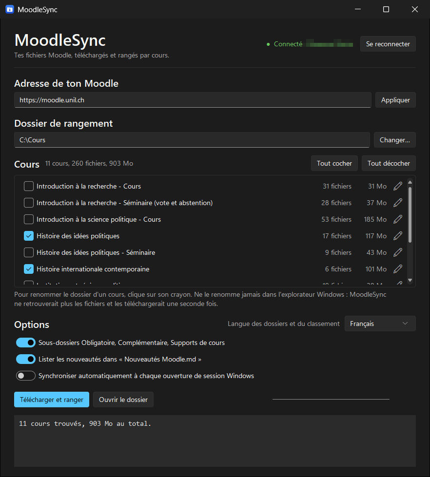
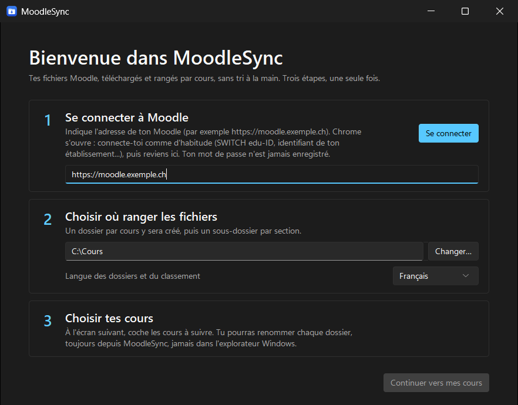
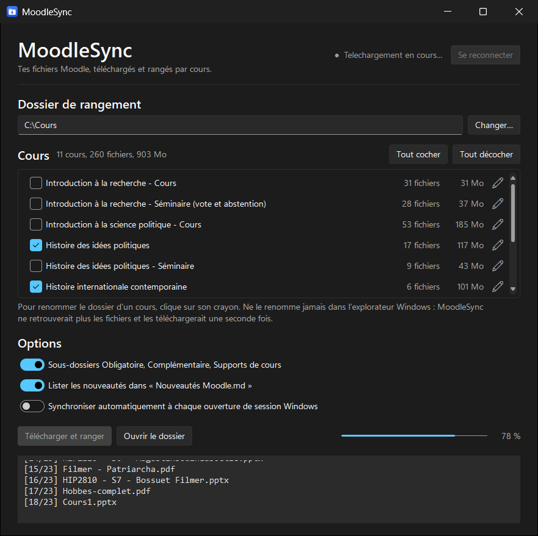
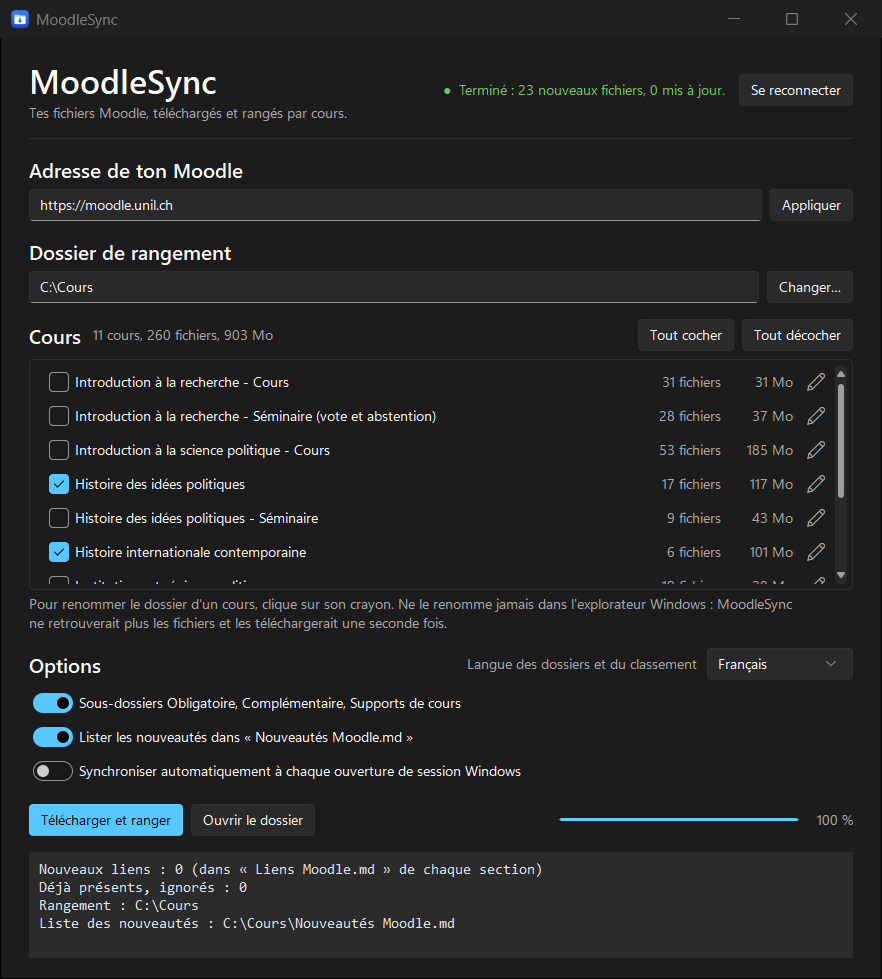
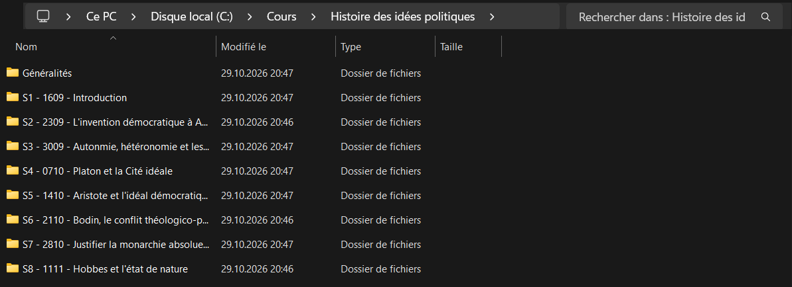

# MoodleSync

Tes fichiers Moodle, téléchargés et rangés par cours, par section et par statut de lecture.
Une petite fenêtre, sous Windows ou macOS, aucune ligne de commande.

Développé et testé sur le Moodle de l'UNIL, il est conçu pour fonctionner avec n'importe quel
Moodle dont l'établissement autorise l'accès par l'application mobile (voir « Autres Moodle »).
À l'usage des étudiants qui veulent retrouver leurs documents de cours proprement classés
sans le faire à la main.



---

## Ce que fait le programme

- **Connexion dans Chrome, avec la méthode de ton établissement** (SWITCH edu-ID à l'UNIL,
  identifiant local ou autre ailleurs). Tu indiques l'adresse de ton Moodle, la fenêtre ouvre
  Chrome, tu te connectes normalement, elle récupère une autorisation temporaire valable
  plusieurs semaines. Le mot de passe n'est jamais stocké.
- **Liste de tes cours** avec le nombre de fichiers et le volume de chacun, à cocher ou décocher.
  À côté de chaque cours, une pastille indique combien de fichiers sont nouveaux ou republiés
  sur Moodle depuis la dernière synchronisation, avant même de lancer le téléchargement.
- **Téléchargement idempotent.** Un fichier déjà présent n'est pas retéléchargé, même s'il a
  été renommé par l'enseignant : la comparaison porte aussi sur le contenu.
- **Fichiers mis à jour.** Si l'enseignant remplace un document, la nouvelle version est
  téléchargée et l'ancienne est conservée sous un nom explicite (`... (ancienne version 2026-10-29).pdf`).
- **Rangement automatique** dans l'arborescence que tu choisis, avec renommage des dossiers de
  cours et sous-dossiers imbriqués si tu veux.
- **Statuts de lecture en option** : Obligatoire, Complémentaire, Pour aller plus loin,
  Supports de cours. Ils viennent de ce que l'enseignant a écrit dans Moodle : étiquettes,
  sous-sections, noms de dossiers, et liste de lectures placée en tête de chaque séance. Seuls les
  supports de cours (diapos, syllabus, consignes) sont aussi reconnus sans indication de
  l'enseignant (voir « À propos des statuts »).
- **Langue des dossiers et du classement** : français ou anglais. Elle règle les noms des
  sous-dossiers de statut, ceux des notes (`Nouveautés Moodle.md` ou `Moodle updates.md`) et
  les mots-clés reconnus dans les étiquettes et les noms de fichiers. L'interface elle-même reste en français.
- **Note de nouveautés** : un fichier `Nouveautés Moodle.md` liste ce qui a été ajouté ou
  modifié lors de la synchronisation.
- **Page de liens** : les liens externes déposés par les enseignants (articles, vidéos) sont
  rassemblés dans `Liens Moodle.md`, section par section, puisque ce ne sont pas des fichiers.
- **Bouton Annuler** pendant une synchronisation : le fichier en cours est abandonné, ceux déjà
  téléchargés restent rangés, et le reste viendra à la synchronisation suivante.
- **Journal** et lancement automatique possible à l'ouverture de session. Dans ce mode, une
  notification du système (Windows ou macOS) annonce les nouveautés, cours par cours ; rien ne
  s'affiche s'il n'y a rien de nouveau.

## Ce que le programme ne fait pas

- Il ne récupère pas les devoirs, forums, quiz et tests : ce ne sont pas des fichiers.
- Il ne suit pas les liens vers des sites externes, il les liste seulement.
- Il ne s'inscrit à aucun cours et ne modifie rien sur Moodle.
- Il ne contourne aucune authentification : il accède à ce à quoi l'étudiant a déjà droit.

## Installation

### Version prête à l'emploi

Télécharge `MoodleSync.exe` dans la page **Releases** de ce dépôt, place-le où tu veux,
et double-clique dessus. Windows affichera un avertissement d'éditeur inconnu, l'exécutable
n'étant pas signé : « Informations complémentaires » puis « Exécuter quand même ».

Prérequis : Windows et Google Chrome installés, et un Moodle qui autorise l'accès mobile.

### Sur Mac

Télécharge `MoodleSync-macOS.zip` (page **Releases**, ou artefact de la dernière exécution de
« Compilation » dans l'onglet **Actions**), décompresse-le et place `MoodleSync.app` dans
**Applications**. L'application n'étant pas signée, macOS la bloque au premier lancement :
double-clique, ferme le message, puis **Réglages Système › Confidentialité et sécurité ›
Ouvrir quand même**. Elle est compilée pour les Mac à puce Apple (M1 et suivants).

Prérequis : Google Chrome installé. La synchronisation automatique passe par un agent de
lancement (`~/Library/LaunchAgents/ch.moodlesync.plist`), sans droit administrateur.

### Depuis le code source

```
python -m pip install selenium sv-ttk
python moodle_sync.py
```

## Utilisation

1. Indique l'adresse de ton Moodle (par exemple `https://moodle.unil.ch`), puis clique sur
   **Se connecter**. Chrome s'ouvre : connecte-toi comme d'habitude, reviens dans la fenêtre.
   La connexion est détectée toute seule.



2. Choisis le dossier de rangement avec **Changer…**, la langue des dossiers, et coche les
   cours voulus.
3. Clique sur **Télécharger et ranger**.



À la fin, la fenêtre indique le nombre de fichiers nouveaux et mis à jour, et où se trouve la note de nouveautés.



Au lancement suivant, il ne reste que l'étape 3. Si la session a expiré, le programme le dit
et propose de se reconnecter.

## Rangement produit



```
<dossier choisi>\
    Institutions et régimes politiques\
        Enseignement du 30.10.2026\
            Supports de cours\
                7_Conférence du Prof Raul Bolo-Rapti.pdf
            Obligatoire\
                S6-Marx2022-LeCapital-Chap1-1.pdf
```

La couche `Obligatoire` / `Complémentaire` / `Pour aller plus loin` / `Supports de cours` (en
anglais `Required` / `Supplementary` / `Further reading` / `Course material`) est optionnelle,
décochée par défaut. Un dossier de cours peut être renommé par double-clic, et une barre oblique inverse
permet d'imbriquer, par exemple `Introduction aux théories économiques\SITE (séminaire)`.

## À propos des statuts

Les enseignants indiquent le statut d'une lecture de plusieurs façons. Le programme en lit
quatre, dans cet ordre :

1. **Une étiquette** placée avant les fichiers (« Lectures obligatoires », « Diapos »...).
2. **Le nom du dossier Moodle** qui contient les fichiers (« Documents et lectures
   complémentaires »).
3. **La liste de lectures écrite en tête de la séance**, sous des intitulés comme « Lectures
   obligatoires : », « Lectures facultatives : », « Pour aller plus loin : ». Les fichiers y sont
   rapprochés des références par l'auteur, l'année et les mots du titre (voir plus bas).
4. **Une sous-section** dont le nom annonce un statut (« Lecture obligatoire » à l'intérieur de
   la séance du 12 octobre). Ses fichiers sont rangés dans le dossier de la séance, et non plus
   dans un dossier à part, détaché de sa date.

Seul le début d'une ligne compte comme intitulé : « L'inscription au séminaire est obligatoire »
ou « Formation obligatoire à Zotero » ne font pas d'un document une lecture obligatoire.

**Rapprochement avec la liste de lectures.** Un fichier n'est rattaché à une référence que si son
nom en reprend l'auteur et l'année, ou l'auteur et un mot propre à cette référence, ou plusieurs
auteurs ou mots du titre, et si ses mots se retrouvent en majorité dans la référence. Les
coquilles légères (« Barraul » pour « Barrault ») et les apostrophes perdues (« LEtat ») sont
tolérées. Dans le doute, rien n'est décidé : un auteur cité deux fois avec deux statuts
différents (un chapitre obligatoire, un autre « pour aller plus loin ») laisse ses fichiers sans
statut, et un texte déposé sans figurer dans la liste n'en reçoit pas. Les diapositives ne sont
jamais rapprochées d'une référence. Le journal indique combien de fichiers ont été classés ainsi.

Mesure sur le séminaire d'Introduction à la science politique de l'UNIL (automne 2026), comparée
au classement fait à la main par l'auteur : sur 39 fichiers cités sous un intitulé, 37 sont
classés, tous dans le bon statut, et 2 restent sans statut (le cas de l'auteur cité deux fois).
Un seul cours ne prouve pas que la règle vaut ailleurs : d'autres formats de liste de lectures
seront moins bien reconnus.

**Sans étiquette, le programme ne déduit que les supports de cours.** Un fichier est classé en
`Supports de cours` quand son extension est celle d'une présentation (`.pptx`, `.key`...) ou
que le nom du fichier ou de son activité Moodle désigne un document de l'enseignant : diapos,
slides, syllabus, consignes, fiche, calendrier, présentation, QCM. Une liste de lectures
(« Syllabus de lectures ») n'en fait pas partie. Chaque synchronisation indique dans le journal
combien de fichiers ont été classés ainsi, par déduction et non d'après l'enseignant.

**Obligatoire, Complémentaire et Pour aller plus loin ne sont jamais devinés.** Seul ce que
l'enseignant a écrit dans Moodle les donne. Un texte qu'aucune indication ne désigne reste donc
directement dans le dossier de sa section, y compris quand l'option est activée. Le syllabus en
PDF n'est pas lu.

Mesure sur un jeu de 248 fichiers de cours que l'auteur avait rangés à la main : les 60 fichiers
déduits comme supports de cours l'étaient tous bien (60 sur 60), mais la règle n'en reconnaît pas
31 autres, qui restent non classés. Ce jeu a servi à choisir les mots-clés : le résultat sur
d'autres cours sera moins bon, et une déduction peut se tromper.

Les intitulés sont reconnus en français ou en anglais selon la langue choisie. Un intitulé
rédigé dans une autre langue n'est pas reconnu.

**Fichiers déjà rangés.** Un nouveau classement ne déplace jamais un fichier déjà téléchargé :
seuls les nouveaux fichiers suivent les nouvelles règles.

## Données personnelles

Les réglages, le jeton de session et le journal restent sur l'ordinateur, dans
`%LOCALAPPDATA%\MoodleSync` (Windows) ou `~/Library/Application Support/MoodleSync` (macOS).
Le programme ne contacte que ton Moodle, et YouTube pour retrouver le titre des vidéos citées
dans les liens (adresse de la vidéo seulement, sans aucune donnée personnelle). Les
notifications sont locales.

Pour tout effacer : supprime ce dossier, ainsi que les fichiers téléchargés. Sous Windows, les
notifications ont aussi inscrit le nom de l'application dans
`HKEY_CURRENT_USER\Software\Classes\AppUserModelId\MoodleSync`, qu'on peut supprimer avec
l'Éditeur du Registre.

Aucun jeton, aucun mot de passe et aucun fichier de cours ne doit être publié dans ce dépôt.

## Construire l'exécutable

```
python -m pip install selenium sv-ttk pyinstaller
pyinstaller --noconfirm --clean MoodleSync.spec
```

La recette `MoodleSync.spec` est versionnée, elle embarque Selenium, son gestionnaire de
pilote et le thème `sv-ttk`. Le résultat apparaît dans `dist\` : `MoodleSync.exe` sous
Windows, `MoodleSync.app` sous macOS (ajouter `pillow` pour convertir l'icône).

Le workflow `.github/workflows/compilation.yml` compile et teste le `.exe` et le `.app` sur des
machines Windows et Mac de GitHub à chaque envoi. Pour publier une version, il suffit d'envoyer
une étiquette `vX.Y` (`git tag v1.2` puis `git push origin v1.2`) : le workflow crée alors la
Release avec les deux exécutables, `docs/LISEZ-MOI.txt` et les notes de `docs/notes-version.md`.

## Autres Moodle

L'adresse du Moodle se règle dans la fenêtre (champ « Adresse de ton Moodle »), plus dans le
code. Changer d'adresse déconnecte l'ancienne session et oublie la liste de cours ; les fichiers
déjà téléchargés ne sont pas touchés.

La connexion ne dépend pas de la méthode d'authentification : c'est Chrome qui la gère, puis le
programme échange la session contre un jeton de service web par le mécanisme de l'application
mobile officielle de Moodle. Deux conséquences.

- **L'établissement doit autoriser l'application mobile.** Certains la désactivent
  (réglage « Moodle mobile web service »). Dans ce cas, MoodleSync ne peut pas fonctionner : le
  programme l'indique par un message dès la vérification de l'adresse ou juste après la
  connexion. Ce n'est un problème ni de ton compte ni de ton mot de passe, et seul
  l'administrateur Moodle de l'établissement peut y changer quelque chose.
- **Seul le Moodle de l'UNIL a été testé.** Les thèmes et les versions varient. Si, après
  connexion, la page n'affiche pas le menu utilisateur habituel de Moodle, le programme déduit la
  connexion de l'adresse de la page et du jeton obtenu, et affiche « Statut inconnu : connexion
  probable » au lieu de « Connecté ». Si tu l'essaies sur un autre Moodle, un retour (ouvre une
  *issue*) est le bienvenu.

## Limites connues

- Un Moodle qui désactive l'accès mobile est inutilisable avec ce programme (voir « Autres Moodle »).
- Les statuts ne couvrent qu'une partie des fichiers : sans indication de l'enseignant, seuls
  les supports de cours à nom explicite sont classés. Les autres restent dans leur section.
- Le rapprochement avec une liste de lectures dépend du nom donné au fichier : un fichier nommé
  `Browning_chap7.pdf`, sans année ni titre, ne peut pas être rattaché avec certitude.
- Annuler n'interrompt pas la lecture de la liste des cours en cours de route : l'arrêt se fait
  entre deux cours, ou entre deux blocs d'un téléchargement.
- La langue ne change que les noms de dossiers, de notes et la reconnaissance des étiquettes,
  pas l'interface. Changer de langue ne renomme pas ce qui est déjà rangé : seuls les nouveaux
  fichiers et les nouvelles notes suivent.
- La version macOS est compilée et lancée automatiquement en ligne, mais n'a pas encore été testée à la main sur un vrai Mac.
- Chrome doit être installé, c'est lui qui porte la connexion edu-ID.
- Les noms de sections viennent de Moodle : ils changent d'un cours et d'un enseignant à l'autre.
- Le premier lancement est le plus fragile : antivirus, dossier OneDrive en lecture seule,
  session expirée. Les messages d'erreur sont écrits pour être compris sans être développeur.

## Licence

MIT, voir `LICENSE`. Les documents téléchargés restent la propriété de leurs auteurs et de
l'UNIL : cet outil ne les rediffuse pas, il les range sur ton disque.
