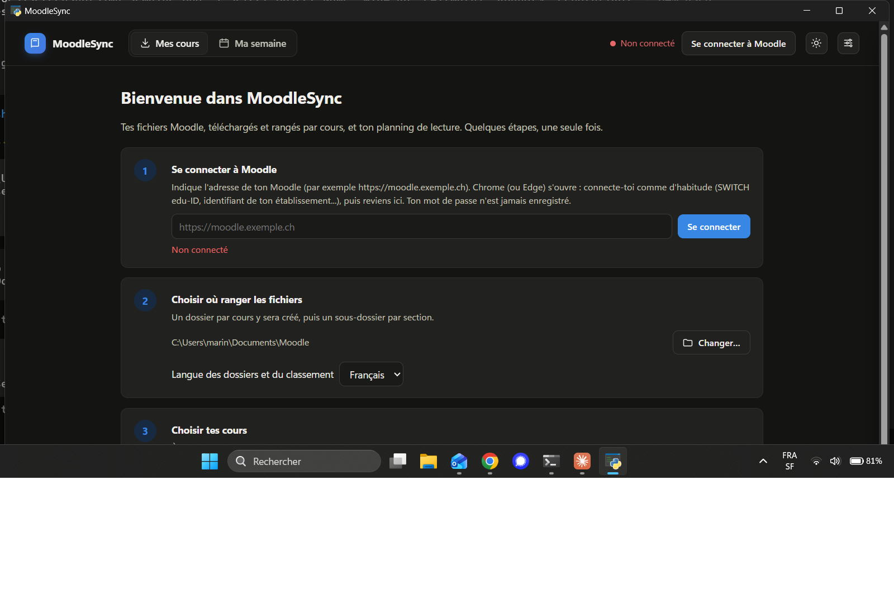
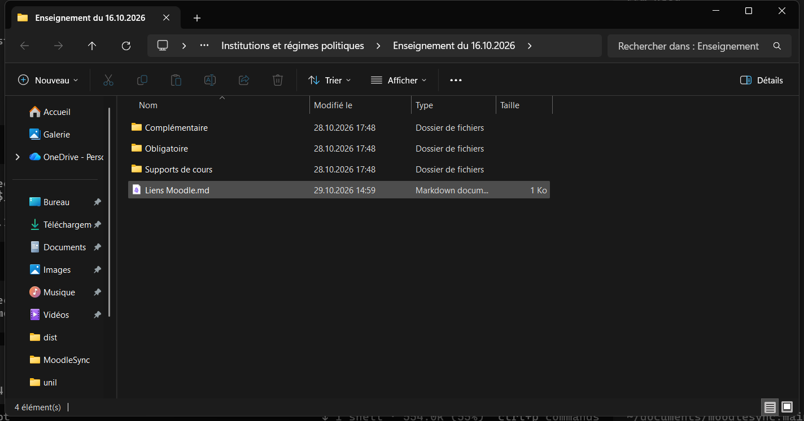
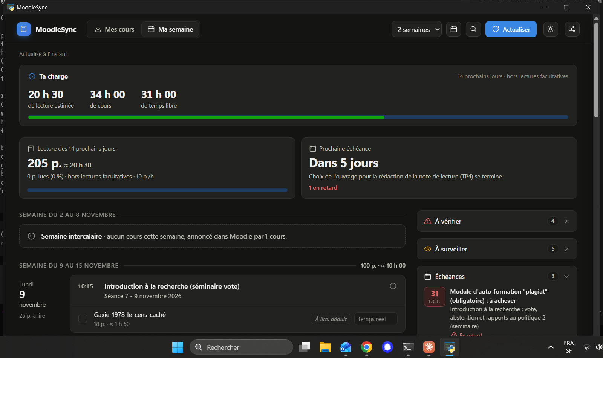

# MoodleSync

> **Tes cours Moodle, rangés tout seuls. Et ta semaine, planifiée.**


MoodleSync, c'est une petite application pour étudiants qui fait trois choses, dans une seule fenêtre :

- **📁 Mes cours** : télécharge tes fichiers Moodle et les range par cours, par séance et par statut de lecture. Sans tri à la main, jamais deux fois le même fichier.
- **📅 Ma semaine** : ton planning de lecture : les séances à venir, quoi lire, combien de temps, quand c'est dû, et ta charge face à ton temps libre.
- **📄 Mes textes** : le texte de tes cours, y compris celui des PDF scannés, prêt à chercher, copier ou exporter.

Conçu et testé sur le Moodle de l'UNIL, il fonctionne avec tout Moodle qui autorise l'application mobile.



---

## Pourquoi c'est pratique

- **Zéro tri manuel.** Les fichiers arrivent déjà rangés, dans les bons dossiers.
- **Rien n'est téléchargé deux fois.** Un fichier déjà là, même renommé par l'enseignant, n'est pas retéléchargé.
- **Les mises à jour sont conservées.** L'ancienne version d'un document est gardée à côté de la nouvelle. Une seule exception, que tu choisis toi-même : le mode « Remplacer par une version cherchable » du texte des cours (voir « Le texte de tes cours »).
- **Tu vois ce qui est nouveau** avant même de lancer le téléchargement.
- **Ta semaine en un coup d'œil.** Séances, lectures, durées estimées, échéances, et ta charge face à ton temps libre.

## Commencer

### Windows

Télécharge `MoodleSync.exe` dans la page [**Releases**](../../releases), place-le où tu veux, double-clique.

> Au premier lancement, Windows affiche un avertissement d'éditeur inconnu (l'application n'est pas signée) : **Informations complémentaires** puis **Exécuter quand même**.

Prérequis : Windows 10 ou 11. Chrome (sinon Edge) pour la connexion, et le composant Edge WebView2 (présent par défaut).

### macOS

Télécharge `MoodleSync-macOS.zip` (page [**Releases**](../../releases)), décompresse, place `MoodleSync.app` dans **Applications**.

> macOS la bloque au premier lancement (application non signée) : **Réglages Système › Confidentialité et sécurité › Ouvrir quand même**.

Prérequis : Google Chrome. Compilée pour les Mac à puce Apple. La version Mac est compilée et essayée automatiquement à chaque version, mais pas à la main sur un vrai Mac : un retour (ticket) est le bienvenu.

### Depuis le code source

```bash
python -m pip install -r requirements.txt
python -m moodlesync
```

Python 3.12 ou plus récent.

## Utilisation

1. Indique l'adresse de ton Moodle (par exemple `https://moodle.unil.ch`), clique **Se connecter**. Chrome (ou Edge) s'ouvre : connecte-toi comme d'habitude, puis reviens dans la fenêtre. La connexion est détectée toute seule.
2. Choisis le dossier de rangement, la langue des dossiers, puis coche tes cours.
3. Clique **Télécharger et ranger**.

Au lancement suivant, il ne reste que l'étape 3. C'est tout.

## Les trois onglets

### 📁 Mes cours

La partie fichiers : la liste de tes cours (avec le nombre de fichiers et ce qui est nouveau), le téléchargement, le rangement, et les options.

Les statuts de lecture (`Obligatoire`, `Complémentaire`, `Pour aller plus loin`, `Supports de cours`) viennent de ce que l'enseignant a écrit dans Moodle : étiquettes, listes de lectures, noms de dossiers. Sans indication, seuls les supports de cours (diapos, syllabus, consignes) sont reconnus ; le reste reste dans sa séance. En cas de doute, rien n'est deviné.



### 📅 Ma semaine

Ton planning, lu en direct dans Moodle (en lecture seule) :

- les séances à venir et **quoi lire** avant chacune, avec le nombre de pages et une **durée estimée** ;
- **ta charge** de la semaine, face à ton temps libre (pose tes cours et tes créneaux « Temps libre » dans l'horaire visuel) ;
- les **échéances** de Moodle et celles que tu ajoutes ;
- ce qui a **changé** dans Moodle depuis la dernière fois.

Tu coches ce que tu as lu et notes ton temps réel : ta vraie vitesse de lecture s'en déduit.

**Lire en plusieurs fois.** Avec « Ma page », tu notes où tu t'es arrêté (et, si tu veux, le temps de cette séance, à la main ou avec le chrono ▶). Le marque-page te ramène à la bonne page, la barre d'avancement et le temps restant se mettent à jour, et la vitesse se mesure **séance par séance** : seules les séances dont tu as noté le temps y entrent, une page notée sans temps ne fausse donc rien.

Une copie `Ma semaine.md`, lisible dans Obsidian, est écrite si tu le veux.

**Lectures facultatives.** Elles ne comptent pas dans les totaux par défaut. L'option « Compter les lectures facultatives » (Réglages, section Ma semaine) les inclut dans le total des pages et des lectures, la jauge, ta charge et `Ma semaine.md`.



### 📄 Mes textes

Le texte de tes cours, prêt à chercher, copier ou exporter. La préparation se lance depuis la carte de Ma semaine. Une fois faite, cet onglet liste les documents, note la qualité de ce qui a été lu et répond à la recherche. Les limites, ce qui est produit et le déroulé de la préparation sont dans la section « Le texte de tes cours », juste après.

## Le texte de tes cours

Un PDF scanné ne contient que des images : pas de Ctrl+F, pas de copier-coller, rien à lire pour une autre application. MoodleSync en extrait le texte sur ton ordinateur, avec un moteur d'extraction qui n'est pas embarqué dans l'application.

### Ce que ça ne fait pas, à lire avant

- **Une page douteuse est signalée, jamais inventée.** Chaque document reçoit « Bon », « À vérifier » ou « Difficile », et le dialogue de qualité liste ceux qui demandent un coup d'œil. Les deux seuils qui décident de ces mots n'ont pas été calibrés sur un corpus réel : le badge dit qu'il faut vérifier, il ne dit pas que le texte est juste.
- **Un remplacement est abandonné au moindre écart.** Avant de rendre un PDF cherchable, MoodleSync compare le résultat à l'original : même nombre de pages, mêmes dimensions et rotations, mêmes annotations, liens et signets, texte extractible, fichier réouvrable, rendu identique sur trois pages échantillonnées. Un seul contrôle qui échoue arrête l'opération : ton fichier d'origine reste en place et rien n'est marqué comme préparé. Une différence sur une page non échantillonnée échappe à ces contrôles.
- **L'original n'est pas conservé, par choix de volume.** Aucun dossier `Originaux/`, aucune copie `.bak`, aucun PDF renommé « ancienne version » : garder deux fois tous tes PDF doublerait le volume du dossier de rangement. Ce qui reste, c'est le texte en Markdown et, en mode « Remplacer », un PDF qui garde ses pages d'origine avec une couche de texte par-dessus.
- **Rien ne part sans ton accord.** L'extraction est désactivée par défaut. Le mode « Remplacer » demande un consentement séparé, qui rappelle qu'aucune copie de l'original n'est gardée.
- **Sous macOS 11 et 12, la préparation d'un PDF scanné n'est probablement pas disponible.** La bibliothèque qui rend les pages de PDF demande macOS 13 ou plus (lu dans la bibliothèque, déduit : jamais essayé sur ces versions). Voir « Limites ».
- **Le moteur du paquet macOS n'a jamais été lancé sur un Mac.** C'est un exécutable pour les Mac à puce Apple (arm64), non signé. Le téléchargement, la vérification de l'empreinte et la décompression des deux paquets ont été mesurés ; le lancement du moteur sous Windows et sous macOS ne l'a pas été.

### Ce que ça fait

1. Coche l'extraction dans les réglages, ou ouvre la carte de Ma semaine et clique sur « Préparer maintenant ». La fenêtre annonce le nombre de documents, le nombre de pages et une durée approximative ; au-delà de 50 documents ou 500 pages, elle demande une confirmation.
2. Tu peux fermer la fenêtre, mettre en pause ou arrêter : la préparation reprend là où elle s'était arrêtée. Elle cède la place à une synchronisation et reprend ensuite. Après ce premier accord, une synchronisation lancée depuis la fenêtre relance la préparation des nouveaux documents, à condition que le moteur soit présent et que le lot ne dépasse pas 50 documents ni 500 pages ; jamais en mode `--auto`. La case des réglages coupe ce lancement automatique.
3. Le moteur d'extraction n'est pas dans l'exécutable. La carte et les réglages proposent de l'installer, ou d'indiquer un moteur déjà installé. L'installation télécharge le paquet de ton système, sans droits d'administrateur : 63 028 791 octets pour Windows (environ 184 Mo une fois décompressé, 183 666 757 octets) et 13 685 896 octets pour macOS (environ 33 Mo décompressé, 33 065 769 octets). Son empreinte SHA-256, inscrite dans le programme, est vérifiée avant toute décompression : un fichier différent est supprimé et rien n'est installé. Sur un autre système, l'installation automatique n'existe pas et la fenêtre te laisse indiquer un moteur à la main.
4. Les résultats sont dans « Mes textes » : la liste par cours et par section, les badges de qualité, la recherche par mot avec la page et l'extrait, la copie du texte ou du contexte d'un cours, l'export en archive ZIP, en archive avec JSONL ou en Markdown, et l'ouverture du fichier de texte.

Deux façons de ranger ce texte, à choisir dans les réglages (liste « Version cherchable des PDF ») :

- **Aucun** (par défaut) : le texte va dans des fichiers Markdown, tes PDF ne sont pas touchés.
- **Remplacer par une version cherchable** : tes pages restent identiques à l'œil, une couche de texte invisible les rend cherchables avec Ctrl+F et copiables dans n'importe quel lecteur de PDF. Choisir ce mode demande un consentement séparé, et la liste rappelle qu'aucune copie de l'original n'est conservée sur ton ordinateur.

### Ce que ça produit

```text
<dossier de rangement>/Textes/index.md
<dossier de rangement>/Textes/Qualité des textes.md
<dossier de rangement>/Textes/<Cours>/<Cours> - texte des documents.md
<dossier de rangement>/Textes/<Cours>/<Section>/article.pdf.md
```

Un fichier par document, avec ses marqueurs de page (`<!-- page 3 -->`) et un front matter qui porte la ligne `moodlesync`. Supprime cette ligne et le fichier n'est plus réécrit. `index.md` donne l'inventaire, `Qualité des textes.md` liste les documents à vérifier. Le cache de la préparation vit dans un dossier caché, à la racine du dossier de rangement, et ne fait pas partie de tes documents.

### Retrouver l'original

Le programme sait retélécharger l'original depuis Moodle, vérifier qu'il s'agit bien de la version qu'il avait remplacée et le remettre en place ; rien n'est remplacé si Moodle propose une autre version, si le cours est fermé ou si tu es hors ligne. Dans « Mes textes », le menu « … » d'un PDF cherchable propose « Restaurer l'original » : une confirmation dit ce que le bouton fait (retélécharger l'original depuis Moodle et remplacer le fichier modifié), et si Moodle est injoignable, une phrase l'explique et le PDF cherchable reste en place.

Une limite de cette restauration, qui tient à sa conception : MoodleSync compare ce qu'il retélécharge à l'état du PDF **au moment du premier remplacement**, sans le comparer à Moodle à ce moment-là. Si tu as modifié un PDF à la main avant le premier remplacement (annotation, rotation, extrait), le remplacement a lieu sans alerte et sa restauration répondra que Moodle propose une version différente : rien n'est alors remplacé, le PDF cherchable reste en place et le fichier tel que Moodle le publie ne revient pas par ce chemin (déduit de la lecture du code, aucun test ne le mesure). La restauration ne tient donc sa promesse que pour un PDF resté tel que MoodleSync l'avait téléchargé.

## Données personnelles

Tout reste sur ton ordinateur : réglages, jeton de session, journal et suivi, dans `%LOCALAPPDATA%\MoodleSync` (Windows) ou `~/Library/Application Support/MoodleSync` (macOS).

Le programme n'accède qu'à :

- **ton Moodle**, avec ton jeton, en lecture seule ;
- **youtube.com**, pour le titre des vidéos citées dans les liens (désactivable) ;
- **github.com**, pour savoir si une nouvelle version existe et la télécharger si tu l'acceptes (désactivable), et pour installer le moteur d'extraction du texte des cours si tu le demandes ;
- **l'adresse d'abonnement de ton horaire**, seulement si tu en as collé une ;
- **le pilote du navigateur** (Selenium), téléchargé à la connexion s'il manque.

Aucun jeton, aucun mot de passe et aucun fichier de cours n'est publié dans ce dépôt.

## Mises à jour

MoodleSync cherche une nouvelle version sur la page [Releases](../../releases) de ce dépôt, au démarrage (une requête au plus toutes les 12 h, désactivable dans **Réglages › Mises à jour**) ou quand tu cliques sur **Rechercher**. Quand une version plus récente existe, un bandeau te le dit ; rien ne s'installe sans ton accord.

Au clic sur **Mettre à jour**, le programme :

1. télécharge le fichier de ta plateforme, uniquement depuis des adresses GitHub en HTTPS ;
2. le compare à l'empreinte SHA-256 que GitHub publie pour ce fichier : sans empreinte, ou si elle diffère, rien n'est installé ;
3. remplace l'application et la relance. Tes réglages, ta connexion et ton suivi sont conservés.

Au moindre échec, l'ancienne version reste en place. Sous Windows, l'ancien `.exe` est renommé en `MoodleSync.exe.ancien` puis effacé au lancement suivant. L'application doit se trouver dans un dossier où tu peux écrire ; sinon, ou lancée depuis le code source, le bandeau propose le téléchargement manuel.

Sans fenêtre : `MoodleSync.exe --maj` met à jour (code de sortie 0 : installée, 10 : déjà à jour, 11 : remplacement impossible ici, 12 : pas de fichier vérifiable, 1 : erreur), avec `--relancer` pour redémarrer ensuite. La synchronisation automatique (`--auto`) ne cherche jamais de mise à jour.

Sur Mac, la mise à jour remplace `MoodleSync.app` de la même façon (archive décompressée avec `ditto`). Ce chemin n'a pas été essayé à la main sur un vrai Mac, seulement testé par des tests automatiques sur des dossiers temporaires.

## Construire l'exécutable

```bash
python -m pip install -r requirements-compilation.txt
python -m unittest discover -s tests -t .
pyinstaller --noconfirm --clean MoodleSync.spec
```

Un workflow GitHub compile et essaie le `.exe` (Windows) et le `.app` (macOS) à chaque envoi, et publie une version dès qu'une étiquette `vX.Y` est envoyée.

## Limites

- Les dates de Ma semaine sont lues en **français seulement** : un cours qui les écrit en anglais, ou pas du tout, sera mal daté ou laissé « à dater ».
- Les statuts ne couvrent que ce que l'enseignant a écrit : le reste n'est pas deviné.
- Le Moodle doit **autoriser l'application mobile** (réglage côté administration) : sinon, rien ne peut se connecter.
- Seul le Moodle de l'UNIL a été testé à la main.
- Les durées de lecture sont des **estimations**, sauf à noter tes temps réels.
- La préparation du texte des cours demande un **moteur d'extraction installé à part** (téléchargé depuis l'application pour Windows et macOS). Le paquet macOS ne contient qu'un moteur arm64 non signé, jamais lancé sur un Mac ; sur un Mac Intel, l'installation échouera (déduit).
- **Sous macOS 11 et 12, le rendu des PDF est indisponible** : la bibliothèque qui dessine les pages demande macOS 13 ou plus, donc MoodleSync ne peut pas préparer un PDF scanné sur ces versions (lu dans la bibliothèque, jamais essayé sur ces versions).
- La qualité du texte reconnu est signalée par un badge, **sans garantie** : les seuils n'ont pas été calibrés sur un corpus réel, un document noté « Bon » peut contenir des erreurs.

## Licence

MIT, voir [LICENSE](LICENSE). Les documents téléchargés restent la propriété de leurs auteurs et de ton établissement : cet outil ne les rediffuse pas, il les range sur ton disque.
